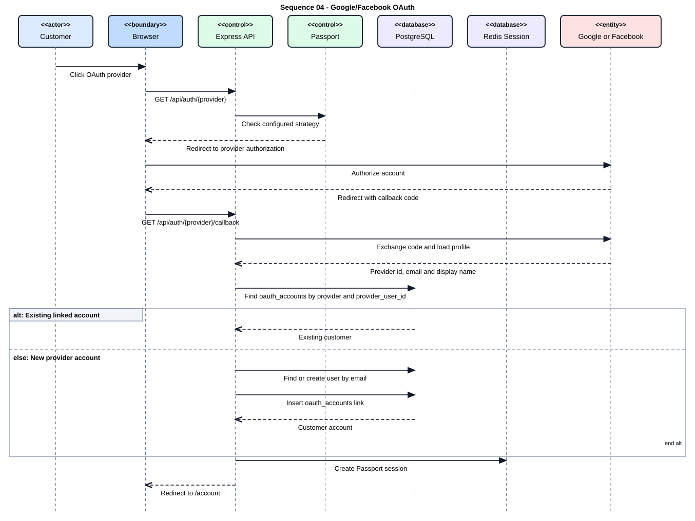
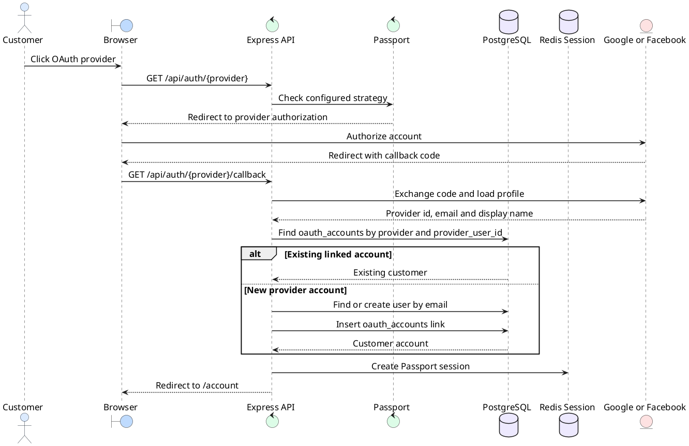

# Sequence 04 - Google/Facebook OAuth

PlantUML source

Related code: `src/config/passport.js`, `src/controllers/authController.js`, `src/routes/authRoutes.js`.

Requirement: OAuth credentials and callback URLs must be configured in `.env` before demonstration.