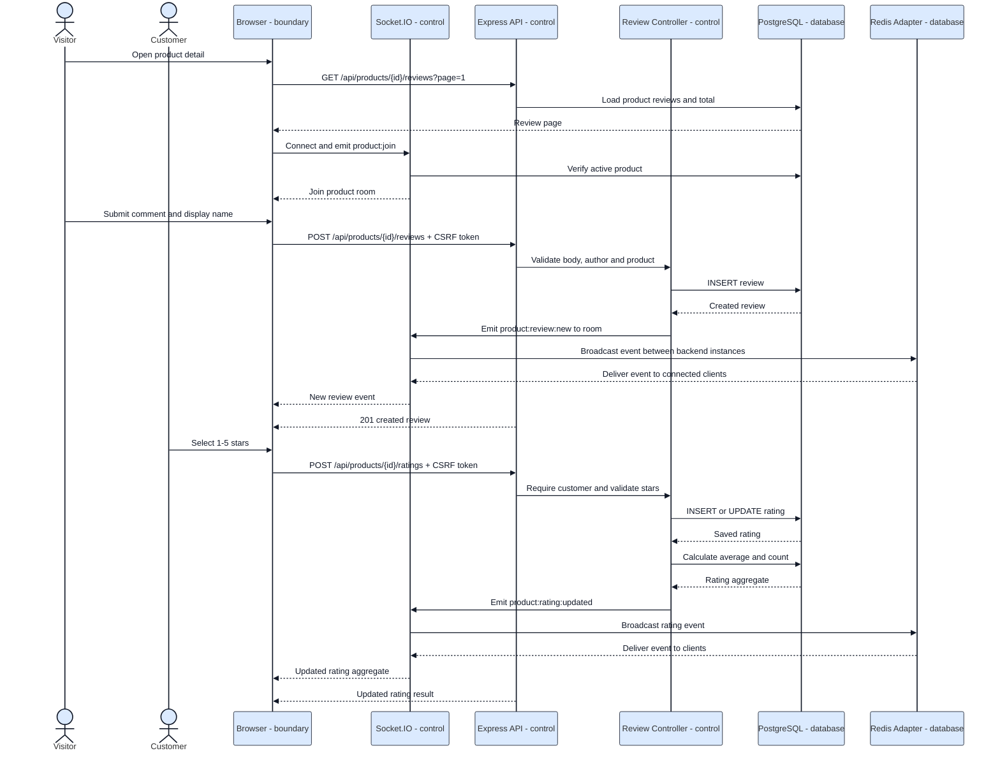

# Sequence 07 - Comment, Rating and Realtime Update

Related code: `frontend/public/js/product.js`, `src/controllers/reviewController.js`, `src/server.js`.

Note: comment does not require login; rating requires an authenticated customer and does not require purchase history.
