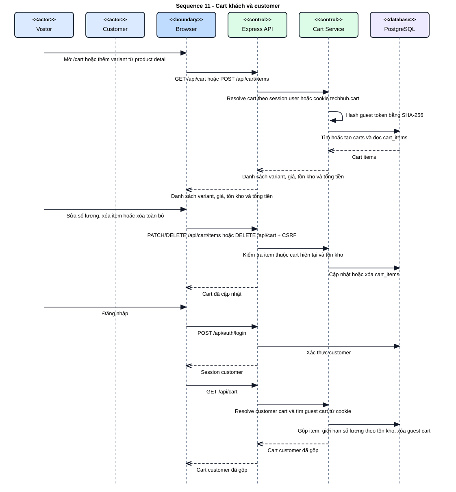
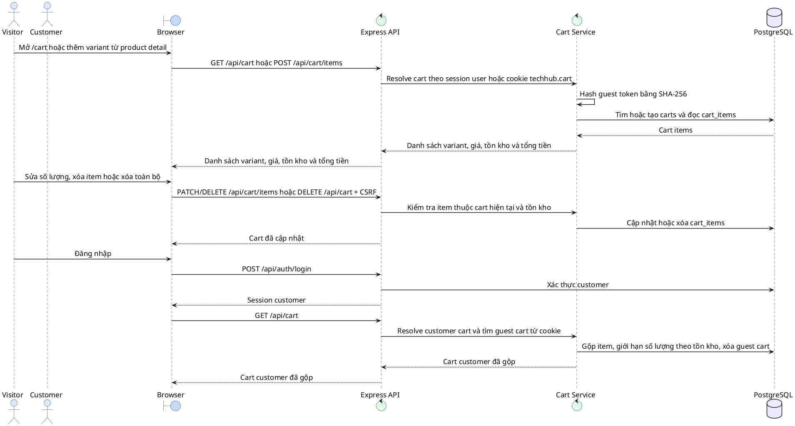

# Sequence 11 - Cart khách và customer

PlantUML source

Related code: `frontend/public/js/cart.js`, `frontend/public/js/product.js`, `src/routes/cartRoutes.js`, `src/controllers/cartController.js`, `src/services/cartService.js`.

API: `GET /api/cart`, `POST /api/cart/items`, `PATCH /api/cart/items/:id`, `DELETE /api/cart/items/:id`, `DELETE /api/cart`. Thêm item yêu cầu quantity 1–99; cập nhật nhận quantity 0–99, trong đó 0 xóa item. Thao tác ghi cần CSRF. Cart guest dùng cookie HttpOnly; DB chỉ lưu hash của token.