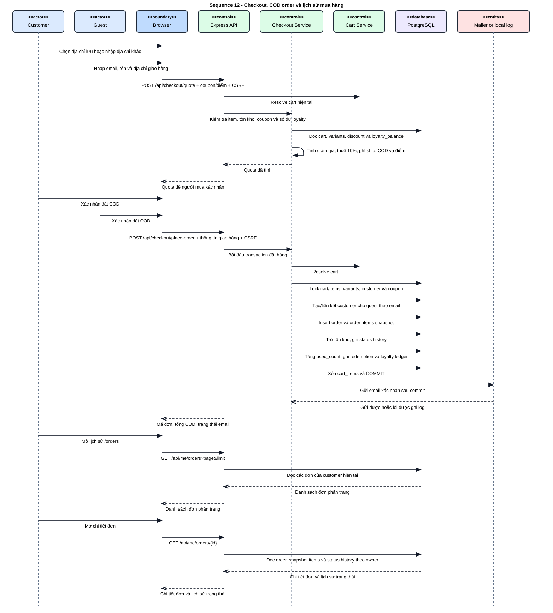
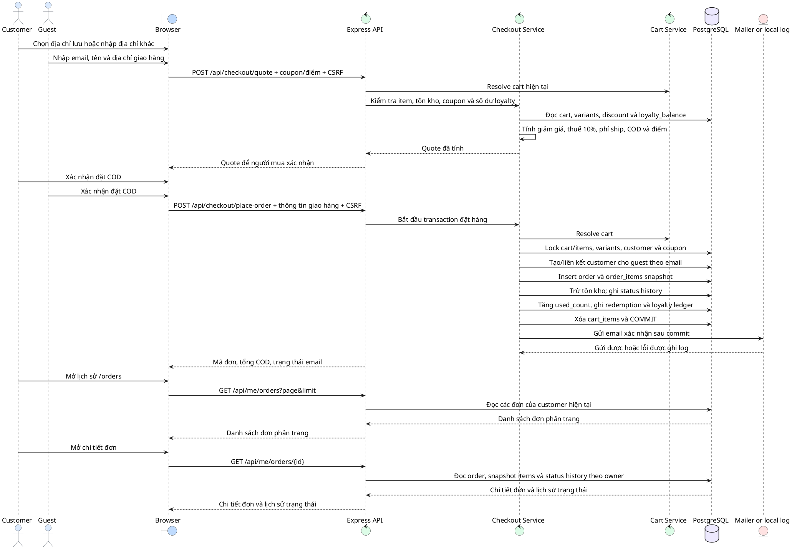

# Sequence 12 - Checkout, COD order và lịch sử mua hàng

PlantUML source

Related code: `frontend/public/js/checkout.js`, `frontend/public/js/orders.js`, `frontend/public/js/order-detail.js`, `src/routes/checkoutRoutes.js`, `src/routes/orderRoutes.js`, `src/services/checkoutService.js`, `src/services/orderService.js`, `src/services/pricing.js`, `src/services/mailer.js`.

`POST /api/checkout/quote` tính preview; `POST /api/checkout/place-order` tính lại và thực hiện giao dịch thật trong transaction. Checkout hỗ trợ địa chỉ đã lưu cho customer hoặc địa chỉ nhập tay, coupon 5 ký tự, loyalty points, thuế 10%, phí giao hàng 30.000đ và miễn phí từ 1.000.000đ. Thanh toán hiện là COD; chưa có payment gateway. Email là hậu xử lý sau commit, nên lỗi SMTP không hủy đơn. Guest order được gắn với customer theo email. Order history/detail yêu cầu đăng nhập; hiện chưa có API cập nhật trạng thái đơn.