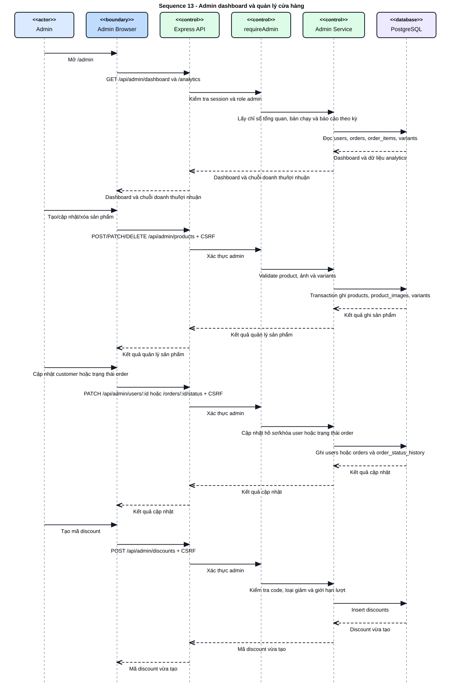
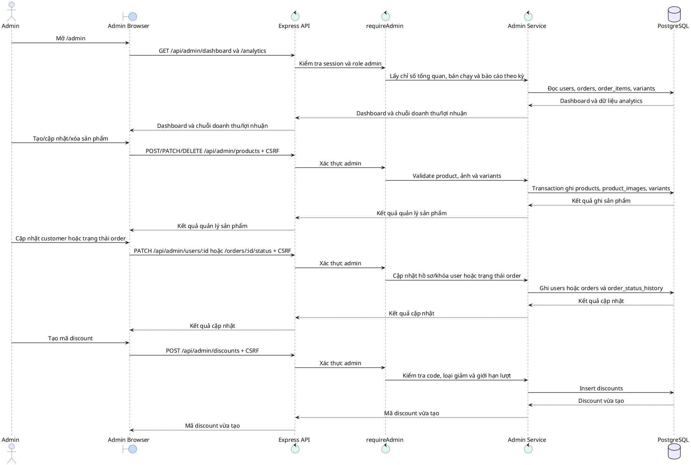

# Sequence 13 - Admin dashboard và quản lý cửa hàng

PlantUML source

Related code: `frontend/views/admin.ejs`, `frontend/public/js/admin.js`, `src/routes/adminRoutes.js`, `src/controllers/adminController.js`, `src/services/adminService.js`, `src/middleware/auth.js`.

`/admin` là frontend page; các API dưới `/api/admin` đều áp dụng `requireAdmin`. Admin hiện có dashboard và báo cáo analytics, CRUD sản phẩm, khóa/sửa customer, đọc và cập nhật trạng thái đơn, cùng tạo/xem discount. Request ghi dữ liệu đi qua CSRF protection. Không có chức năng xóa user hoặc xóa discount trong routes hiện tại.