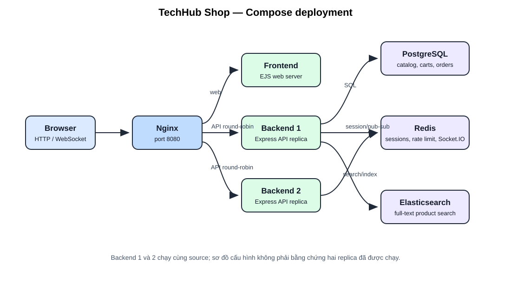

# Bonus: Nginx round-robin và stateless backend



Luồng request: trình duyệt → Nginx → frontend hoặc một trong hai API backend. Redis chia sẻ session và hỗ trợ Socket.IO giữa API; PostgreSQL giữ dữ liệu nghiệp vụ; Elasticsearch phục vụ tìm kiếm. Hai backend là hai replica của cùng ứng dụng Express, không phải microservice.

## Thiết kế trong source

- `source/docker-compose.yml` khai báo hai service API: `backend-1` và `backend-2`.
- `source/nginx/default.conf` khai báo cả hai địa chỉ trong upstream `shop_backend`. Nginx dùng round-robin mặc định và DNS resolver Docker để cập nhật địa chỉ container.
- Session Express nằm trong Redis. Catalog/cart/order nằm trong PostgreSQL; hai API process không cần session trong RAM riêng.
- `GET /api/instance` trả `hostname`. Backend cũng ghi hostname khi khởi động.

## Trạng thái bằng chứng

Đã từng có hai backend container chạy ở cấu hình Compose trước khi thêm service Elasticsearch và tách thành `backend-1`/`backend-2`. **Cấu hình Compose hiện tại chưa được khởi động kiểm tra** do Docker Engine trên máy phát triển trả lỗi permission denied. Chưa có bằng chứng request được phân phối qua cả hai hostname.

## Chạy và chụp bằng chứng

1. Khởi động Docker Desktop, từ thư mục repository chạy `cd source` rồi `docker compose up -d`.
2. Chụp `docker compose ps backend-1 backend-2 nginx` vào `evidence/14-scaling-containers.png`.
3. Trong PowerShell chạy:

   ```powershell
   1..10 | ForEach-Object {
     (Invoke-RestMethod http://localhost:8081/api/instance).hostname
   } | Group-Object
   ```

4. Chụp kết quả có cả `techhub-api-1` và `techhub-api-2` vào `evidence/14-scaling-hostnames.png`.
5. Lấy log bằng `docker compose logs --tail=30 backend-1 backend-2`; xác nhận mỗi log có hostname tương ứng.

Không dùng ảnh giả lập. Nếu chỉ thấy một hostname, chưa đánh dấu round-robin đã xác nhận.
