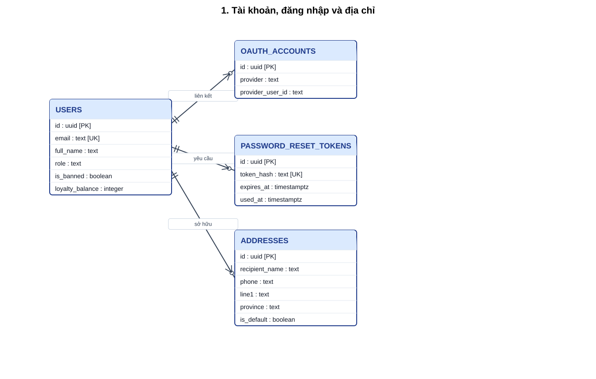
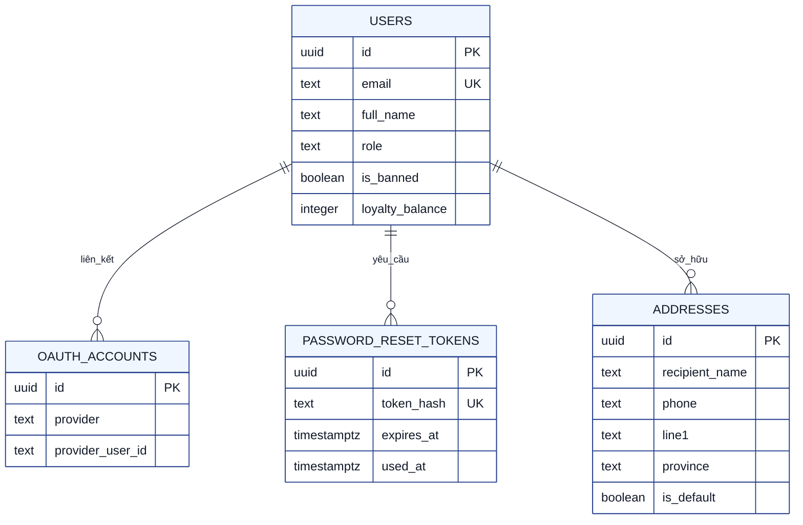
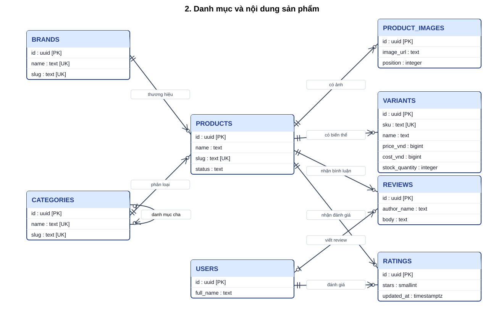
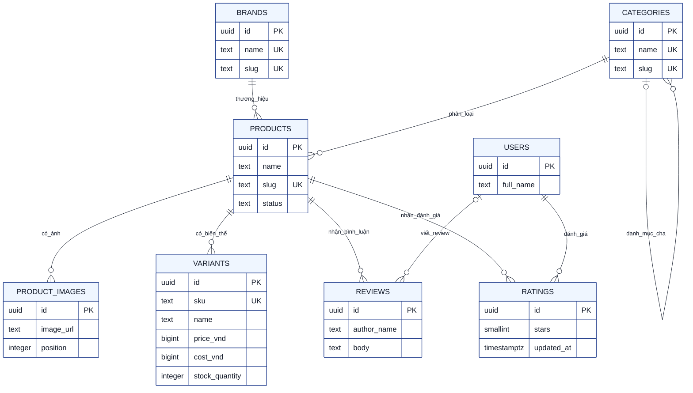
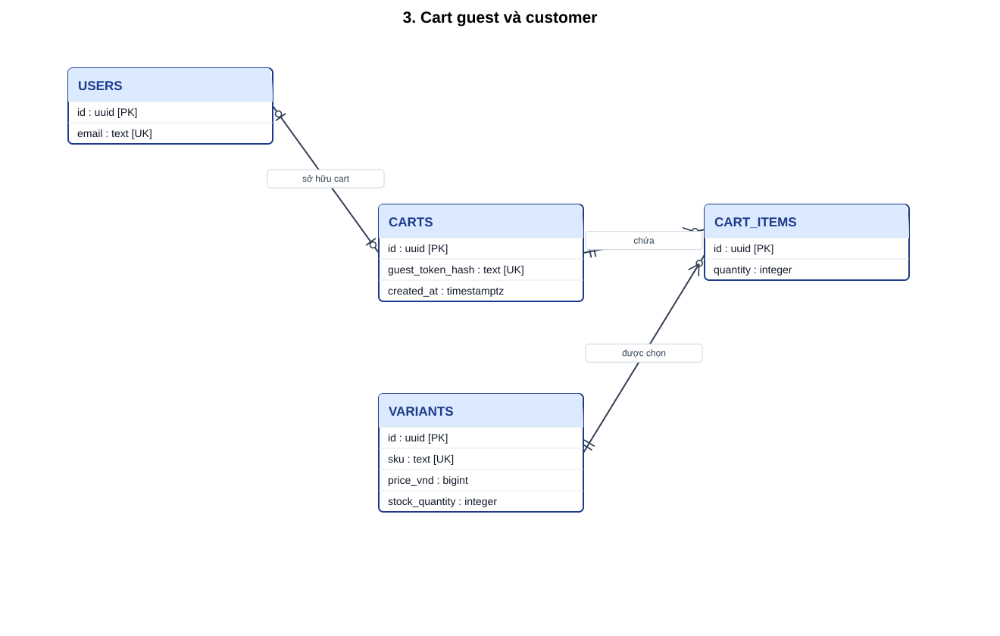
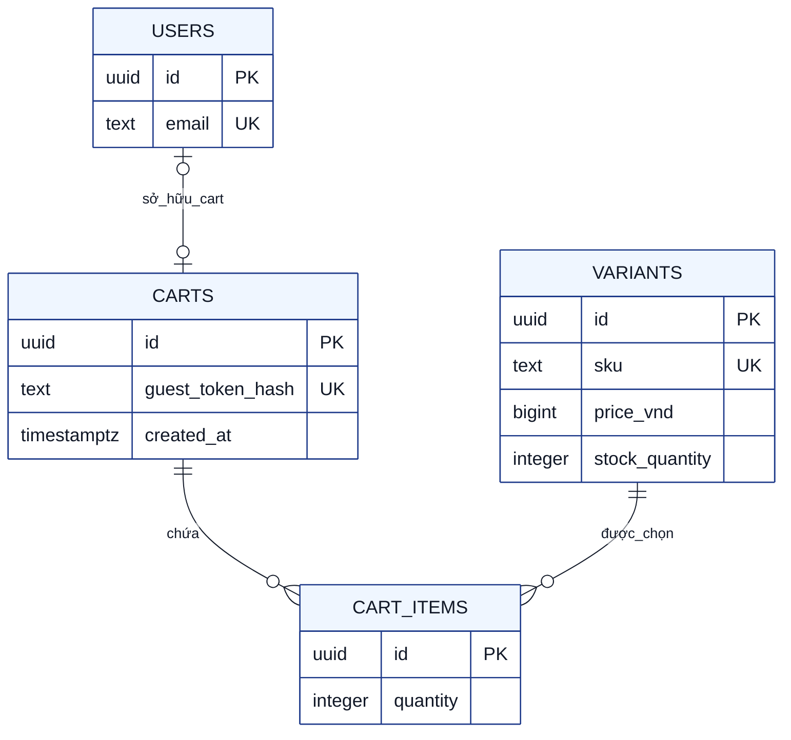
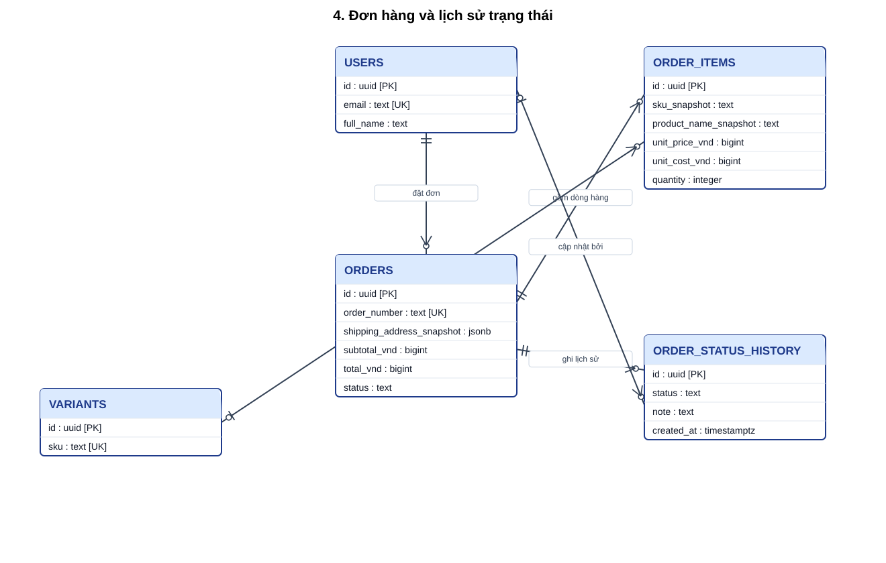
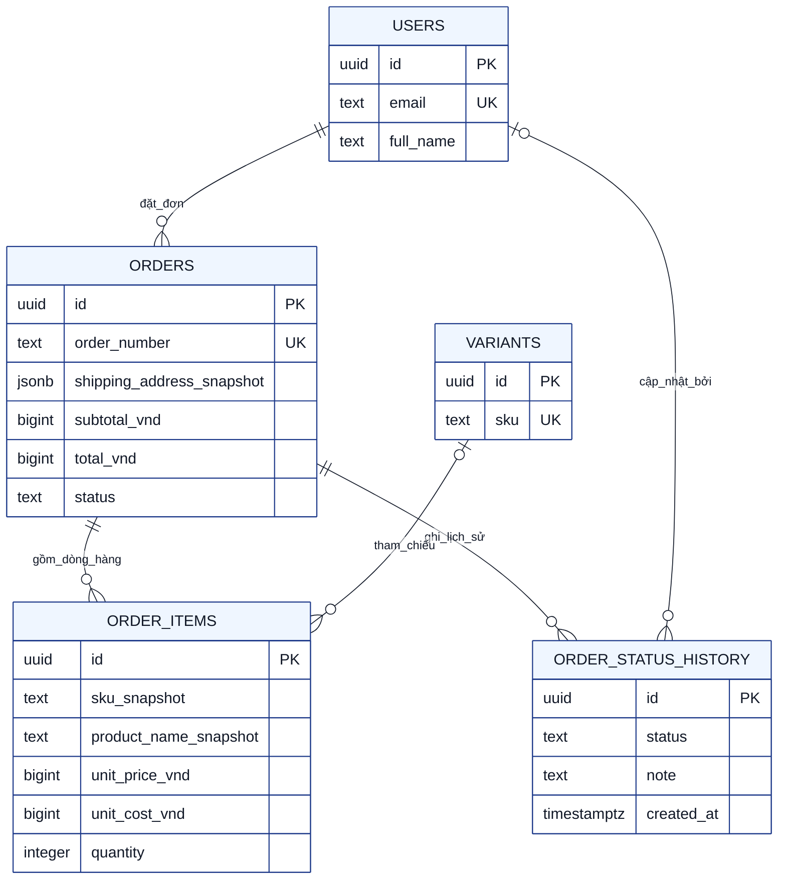
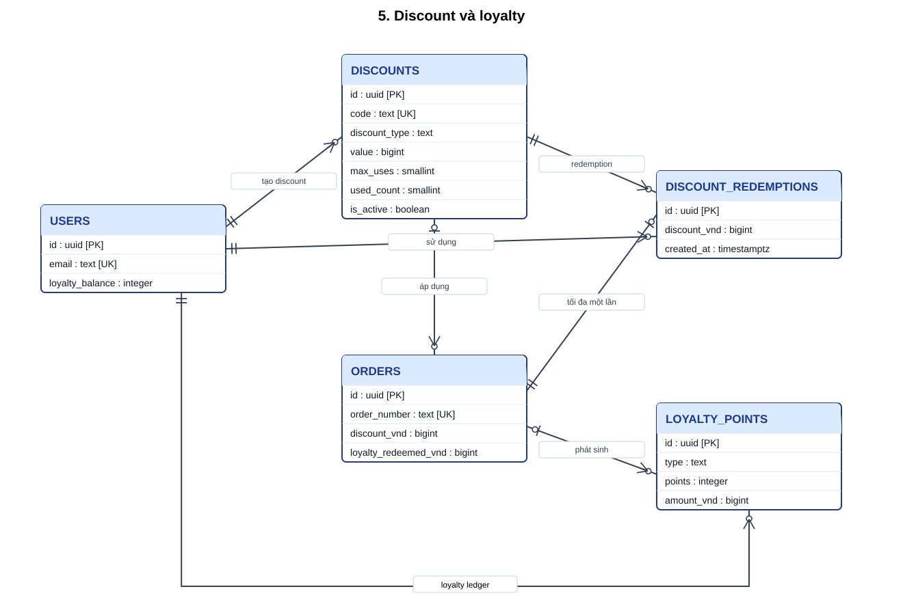
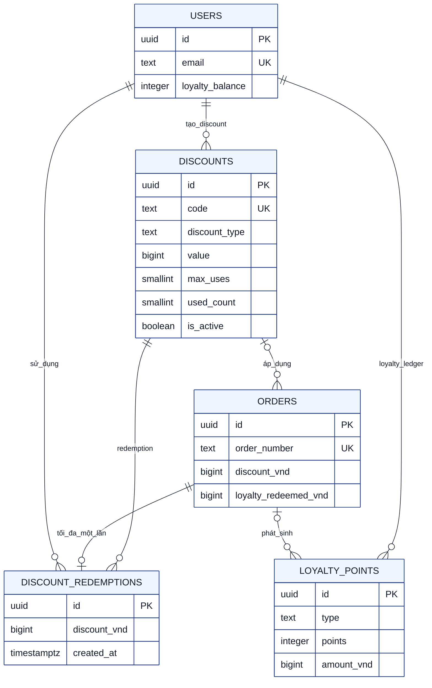

# TechHub Shop — ERD theo nhóm nghiệp vụ

Các hình bên dưới bám theo `db/schema.sql` và migration hiện tại. ERD được tách nhỏ để dễ đọc; bảng cha/con nối với nhau bằng đường quan hệ có cardinality. Vì đường quan hệ đã biểu diễn khóa ngoại, các box chỉ liệt kê khóa chính và thuộc tính đáng chú ý, không lặp lại cột FK.

Ký hiệu ở đầu mỗi đường nói số bản ghi có thể tham gia quan hệ: `||` là đúng một, `o|` là không hoặc một, `o{` là không hoặc nhiều. Ví dụ `USERS ||--o{ ADDRESSES` nghĩa một user có thể có nhiều địa chỉ, còn mỗi địa chỉ thuộc đúng một user. Với quan hệ tùy chọn, phía `o|` khớp FK nullable trong schema.

## 1. Tài khoản, đăng nhập và địa chỉ

Mermaid source

## 2. Danh mục và nội dung sản phẩm

Mermaid source

`variants.cost_vnd` là giá vốn hiện dùng cho báo cáo lợi nhuận quản trị. Mỗi rating gắn với một customer/product duy nhất; review có thể không gắn user nếu được gửi khi chưa đăng nhập.

## 3. Cart guest và customer

Mermaid source

Mỗi cart thuộc đúng một customer hoặc guest token: hai định danh loại trừ nhau bằng CHECK constraint. Guest token trong cookie được hash trước khi lưu. Khi customer đăng nhập, cart guest được gộp vào cart customer.

## 4. Đơn hàng và lịch sử trạng thái

Mermaid source

Guest checkout tạo/liên kết customer theo email nên `orders.user_id` luôn có giá trị. Order và từng item giữ snapshot để lịch sử mua không đổi khi sản phẩm hoặc địa chỉ được chỉnh sửa. `order_items.variant_id` có thể NULL nếu variant được xóa; dòng hàng snapshot vẫn được giữ.

## 5. Discount và loyalty

Mermaid source

Discount redemption có tối đa một dòng cho mỗi order nhờ UNIQUE `order_id`. Loyalty ledger lưu earned/redeemed/adjustment; order link có thể NULL cho giao dịch điều chỉnh độc lập. Admin tạo discount; source hiện hỗ trợ tạo và xem danh sách mã.

## Ràng buộc chính trong schema

- Chỉ một tài khoản có role `admin`; mỗi customer có tối đa một cart; mỗi customer có tối đa một địa chỉ mặc định.
- Một customer chỉ đánh giá một lần cho mỗi sản phẩm; số sao từ 1 đến 5.
- SKU, email, slug sản phẩm và mã discount là duy nhất. Mã discount có đúng 5 ký tự chữ-số, tối đa 10 lượt sử dụng.
- Giá, giá vốn và tồn kho không âm; số lượng trong cart/order phải lớn hơn 0.
- Product status chỉ nhận `active` hoặc `hidden`; order status hiện được service giới hạn trong `pending`, `confirmed`, `processing`, `shipped`, `delivered`, `cancelled`.

## Phạm vi tính năng theo source hiện tại

- Đã có cart, quote/checkout COD, tạo order trong transaction, coupon, loyalty, email sau commit và customer order history.
- Đã có admin dashboard/analytics, quản lý sản phẩm/customer/order và discount; luồng admin được mô tả ở `bonus/13-admin.md`.
- Chưa có payment gateway; hình ERD mô tả schema chứ không biểu diễn trạng thái triển khai hay hệ thống bên ngoài.
