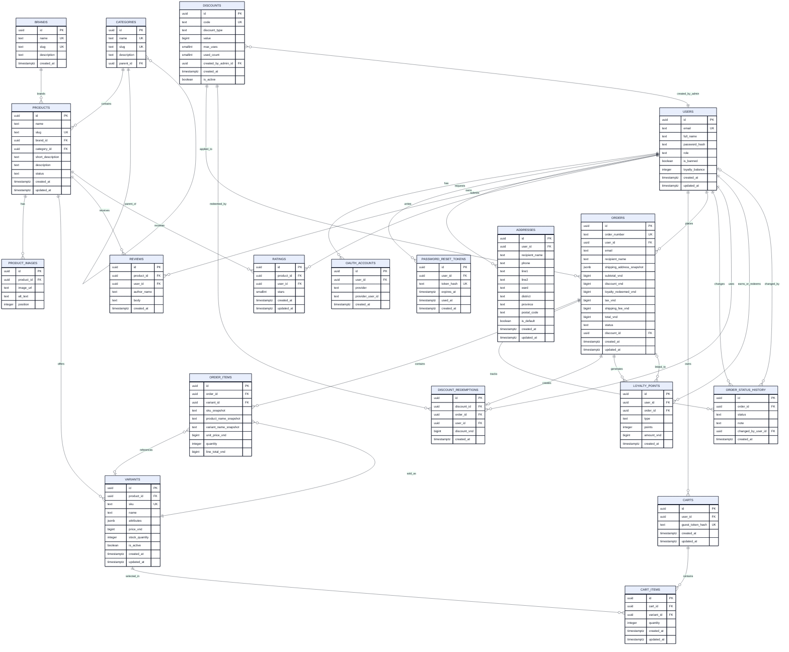

# TechHub Shop - ERD

Sơ đồ dưới đây mô tả database hiện tại trong `db/schema.sql`. Các bảng `carts`, `orders`, `discounts` và `loyalty_points` đã có trong schema để chuẩn bị cho các chức năng tương ứng; việc có bảng chưa đồng nghĩa nghiệp vụ đã được triển khai trong Node.js.

## Bảng mô tả entity

Bảng dưới đây là phần ERD dạng bảng, dùng để tra cứu nhanh các entity trong hình bên trên.

| Entity | Khóa chính | Khóa ngoại chính | Mục đích |
|---|---|---|---|
| `users` | `id` | - | Tài khoản customer/admin, trạng thái khóa và số dư loyalty |
| `oauth_accounts` | `id` | `user_id -> users.id` | Liên kết tài khoản Google/Facebook |
| `password_reset_tokens` | `id` | `user_id -> users.id` | Token khôi phục mật khẩu có thời hạn |
| `addresses` | `id` | `user_id -> users.id` | Nhiều địa chỉ giao hàng của user |
| `brands` | `id` | - | Thương hiệu sản phẩm |
| `categories` | `id` | `parent_id -> categories.id` | Danh mục sản phẩm cha/con |
| `products` | `id` | `brand_id -> brands.id`, `category_id -> categories.id` | Thông tin sản phẩm |
| `product_images` | `id` | `product_id -> products.id` | Nhiều ảnh của sản phẩm |
| `variants` | `id` | `product_id -> products.id` | Variant, SKU, giá và tồn kho độc lập |
| `reviews` | `id` | `product_id -> products.id`, `user_id -> users.id` | Bình luận, có thể là guest comment |
| `ratings` | `id` | `product_id -> products.id`, `user_id -> users.id` | Rating 1-5 sao của customer |
| `carts` | `id` | `user_id -> users.id` hoặc guest token | Giỏ hàng của user hoặc guest |
| `cart_items` | `id` | `cart_id -> carts.id`, `variant_id -> variants.id` | Các variant và số lượng trong cart |
| `discounts` | `id` | `created_by_admin_id -> users.id` | Mã giảm giá do admin tạo |
| `orders` | `id` | `user_id -> users.id`, `discount_id -> discounts.id` | Đơn hàng và tổng tiền tại thời điểm mua |
| `order_items` | `id` | `order_id -> orders.id`, `variant_id -> variants.id` | Chi tiết sản phẩm trong order, có snapshot giá |
| `order_status_history` | `id` | `order_id -> orders.id`, `changed_by_user_id -> users.id` | Lịch sử thay đổi trạng thái order |
| `discount_redemptions` | `id` | `discount_id -> discounts.id`, `order_id -> orders.id`, `user_id -> users.id` | Lưu việc sử dụng discount trong order |
| `loyalty_points` | `id` | `user_id -> users.id`, `order_id -> orders.id` | Điểm earned/redeemed/adjustment |

## Bảng khóa và ràng buộc

| Bảng | Ràng buộc quan trọng |
|---|---|
| `users` | `email` duy nhất; chỉ một user có role `admin` |
| `addresses` | Mỗi user chỉ có một địa chỉ `is_default = TRUE` |
| `products` | `slug` duy nhất; status chỉ là `active` hoặc `hidden` |
| `variants` | `sku` duy nhất; giá và tồn kho không âm |
| `ratings` | Một user chỉ rating một product một lần; stars từ 1 đến 5 |
| `carts` | Cart phải thuộc user hoặc có guest token, không được đồng thời cả hai |
| `cart_items` | Một variant chỉ xuất hiện một lần trong cùng cart; quantity lớn hơn 0 |
| `discounts` | Code đúng 5 ký tự chữ/số; số lượt dùng tối đa là 10 |
| `orders` | `order_number` duy nhất; lưu snapshot địa chỉ và giá trị đơn |
| `discount_redemptions` | Một order chỉ có tối đa một redemption record |

## Quan hệ chính

1. `users` là bảng trung tâm cho customer và admin.
2. Một user có thể có nhiều OAuth account, password reset token, địa chỉ, review, rating, cart, order và loyalty record.
3. Một product thuộc một brand và một category; product có nhiều image, variant, review và rating.
4. Một cart có nhiều `cart_items`; mỗi cart item trỏ tới một variant.
5. Một order thuộc một user và có nhiều `order_items`, `order_status_history` và loyalty record.
6. `order_items` lưu snapshot tên sản phẩm, SKU, tên variant và giá tại thời điểm mua để không phụ thuộc dữ liệu product thay đổi sau này.
7. `shipping_address_snapshot` trong `orders` lưu địa chỉ tại thời điểm đặt hàng.
8. `discount_redemptions` liên kết discount, order và user; `order_id` là duy nhất nên một order chỉ có một redemption record.
9. `categories.parent_id` cho phép tạo danh mục cha/con.

## Ràng buộc đáng chú ý

- Chỉ có một user có role `admin` nhờ partial unique index `one_admin_only`.
- Mỗi user chỉ có một địa chỉ mặc định nhờ partial unique index `one_default_address_per_user`.
- Một user chỉ được rating một lần cho mỗi product nhờ `UNIQUE(product_id, user_id)`.
- Discount code có đúng 5 ký tự chữ và số, `max_uses` từ 1 đến 10.
- Variant phải có giá và tồn kho không âm.
- Rating phải nằm trong khoảng 1 đến 5 sao.
- Cart phải là cart của user hoặc guest token, không được đồng thời có cả hai.
- Product status hiện chỉ nhận `active` hoặc `hidden`.
